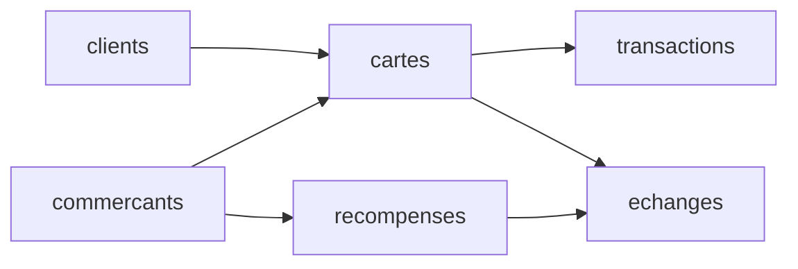

# Programme de fidélité WallX — projet SQL avancé

Base PostgreSQL d'un programme de fidélité : une carte par (client, commerçant),
des points gagnés à chaque achat (1 € = 10 points) et échangés contre des
récompenses. La base garantit elle-même l'**intégrité des points** — on ne forge
pas de points, on ne dépense jamais plus que son solde, on n'échange pas une
récompense d'un autre commerçant — quel que soit le canal (caisse, appli, web).

**Groupe :** Souleymane Sall (@wallxsupport), Lydia El Gh. (@lydia-elgh), Michael Esclavy (@Michi-esc)

## Lancer le projet

Sur une base PostgreSQL vide :

```bash
docker compose up -d
docker compose exec -T db psql -U wallx -d projet < projet.sql
docker compose exec db psql -U wallx -d projet        # pour explorer
```

`projet.sql` s'exécute d'un bloc, dans l'ordre : tables, données, fonction et
procédure, triggers, vues, rôles, index.

## Le modèle

6 tables reliées : `commercants`, `clients`, `cartes` (une par client et
commerçant), `transactions` (les achats qui créditent des points — **20 000
lignes**), `recompenses`, `echanges` (les dépenses de points).



---

## Les éléments du cours

### Fonction — `solde_points(carte)`
- **Ce qu'elle fait :** renvoie le solde d'une carte = points gagnés
  (`transactions`) − points dépensés (`echanges`).
- **Pourquoi :** le solde est calculé à un seul endroit ; le trigger et les vues
  s'en servent sans redéfinir le calcul.
- **La preuve :**
  ```sql
  SELECT solde_points(1);
  ```

### Procédure — `echanger_recompense(carte, recompense)`
- **Ce qu'elle fait :** enregistre un échange après avoir vérifié que la carte
  existe et est active, et que la récompense appartient au bon commerçant. Elle
  refuse les cas invalides avec `RAISE EXCEPTION`.
- **Pourquoi :** c'est une action (elle écrit) ; en cas d'erreur, tout est annulé,
  jamais d'échange à moitié écrit.
- **La preuve :**
  ```sql
  CALL echanger_recompense(1, 1);                 -- ok
  CALL echanger_recompense(1, 999);               -- ERROR: Récompense 999 indisponible
  ```

### Triggers (BEFORE INSERT — un trigger protège, il ne pilote pas)

**`echanges_controler` (BEFORE INSERT ON echanges)** — rend chaque échange
infalsifiable, quel que soit le canal :
- refuse une carte inconnue ou **bloquée** ;
- refuse une récompense inactive ou **d'un autre commerçant** ;
- **fixe lui-même** `points_depenses` au coût réel de la récompense (une valeur
  fournie est ignorée) ;
- refuse si le **solde est insuffisant**.

**`transactions_controler` (BEFORE INSERT ON transactions)** :
- refuse de créditer une carte **bloquée** ;
- **calcule** `points = montant × 10` — on ne peut pas forger de points.

- **Pourquoi dans la base plutôt que dans l'application :** ces règles doivent
  tenir quel que soit le chemin (caisse, appli, web). Si chaque application les
  vérifiait de son côté, un seul oubli permettrait de créer des points à partir
  de rien. En base, elles sont impossibles à contourner.
- **Les preuves :**
  ```sql
  -- récompense d'un AUTRE commerçant (carte 1 = comm. 1, récompense 2 = comm. 2)
  INSERT INTO echanges (carte_id, recompense_id, points_depenses) VALUES (1, 2, 500);
  -- ERROR: Récompense 2 appartient à un autre commerçant

  -- points forgés ignorés : on envoie 999999 pour un achat de 5 € → 50 points stockés
  INSERT INTO transactions (carte_id, montant_euros, points, canal)
  VALUES (1, 5.00, 999999, 'caisse') RETURNING points;          -- points = 50

  -- carte bloquée (carte 50) : aucun crédit
  INSERT INTO transactions (carte_id, montant_euros, points, canal)
  VALUES (50, 10, 100, 'caisse');     -- ERROR: Carte 50 bloquée …

  -- solde insuffisant : sur une carte neuve (0 point), l'échange est refusé
  -- ERROR: Solde insuffisant pour la carte N : solde = 0, coût = 500
  ```

### Vues
- **`vue_caissier` :** solde d'une carte + client au nom masqué (`Prenom N.`),
  sans e-mail ni nom complet. Le caissier a le droit sur la vue, **pas** sur la
  table `clients`.
- **`vue_analyste` :** statistiques agrégées par commerçant (cartes, nombre de
  transactions, points distribués, CA). Aucune donnée nominative.
- **Pourquoi :** la vue cache la complexité des jointures et protège les données
  personnelles. On donne le droit sur la vue, pas sur les tables.

### Rôles et privilèges
- **`caissier`** (rôle-métier, utilisateur `emma`) : lit le catalogue et
  l'historique, crédite des points, enregistre des échanges — mais ne lit pas la
  table `clients`.
- **`analyste`** (rôle-métier, utilisateur `hugo`) : lecture seule, et seulement
  sur `vue_analyste`.
- **Pourquoi :** moindre privilège. Les droits vont au rôle-métier ; la personne
  en hérite. Quand elle part, on supprime la personne, pas les droits.
- **La preuve :**
  ```sql
  SET ROLE emma;
  SELECT * FROM vue_caissier LIMIT 3;   -- autorisé
  SELECT * FROM clients LIMIT 3;        -- ERROR: permission denied for table clients
  RESET ROLE;

  SET ROLE hugo;
  SELECT * FROM vue_analyste;           -- autorisé
  SELECT * FROM transactions LIMIT 3;   -- ERROR: permission denied for table transactions
  RESET ROLE;
  ```

### Index (justifiés par une mesure avant / après)
On mesure avec `EXPLAIN ANALYZE` (lancer **deux fois**, garder la 2ᵉ mesure),
d'abord sans l'index, puis après l'avoir créé.

Mesures faites sur 20 000 transactions (PostgreSQL 16, `EXPLAIN ANALYZE` lancé
deux fois, 2ᵉ mesure retenue).

**Index 1 — `transactions_carte_idx` sur `transactions(carte_id)`**
L'historique d'une carte. Clé étrangère : PostgreSQL ne l'indexe pas tout seul.
```sql
EXPLAIN ANALYZE SELECT * FROM transactions WHERE carte_id = 42;
```
- Avant : `Seq Scan`, **1,23 ms**
- Après : `Bitmap Index Scan` via `transactions_carte_idx`, **0,05 ms** — ~23× plus rapide.

**Index 2 — `transactions_cree_le_idx` sur `transactions(cree_le)`**
Les transactions d'une journée.
```sql
EXPLAIN ANALYZE SELECT * FROM transactions
WHERE cree_le >= '2026-03-01' AND cree_le < '2026-03-02';
```
- Avant : `Seq Scan`, **1,58 ms**
- Après : `Bitmap Index Scan` via `transactions_cree_le_idx`, **0,12 ms** — ~13× plus rapide.

**L'index inutile (pour montrer le jugement)** : un index sur
`transactions(montant_euros)` pour une requête qui ramène (presque) toute la
table reste en `Seq Scan` — PostgreSQL ignore l'index, car lire l'index puis
toute la table coûterait plus cher que lire la table directement.
```sql
EXPLAIN ANALYZE SELECT * FROM transactions WHERE montant_euros > 0;  -- 20 000 lignes
```
- Avec ou sans index : `Seq Scan`, ~5 ms. On ne garde donc pas cet index
  (`DROP INDEX`).

---

## Contribuer
Chaque membre commite son propre travail — l'historique Git montre qui a fait
quoi. Une partie par personne (tables/données, fonction/procédure/trigger,
vues/rôles, index/README).

---

# Comprendre et défendre le projet (révision)

> Le jour de la présentation (8 min de démo + 4 min de questions), **le prof
> interroge un membre au hasard** : chacun doit pouvoir expliquer n'importe
> quelle partie. Cette section contient tout ce qu'il faut savoir.

## La démo, pas à pas (trame imposée : rôle → vue → index → trigger)

Préparer ces requêtes dans un fichier et les jouer **en direct sur la base**
(pas de diaporama). D'abord lancer le script, puis :

```sql
-- 0) Montrer que tout est chargé
SELECT count(*) FROM transactions;         -- 20 000

-- 1) UN RÔLE : moindre privilège
SET ROLE emma;                             -- Emma travaille au guichet (rôle caissier)
SELECT * FROM vue_caissier LIMIT 3;        -- AUTORISÉ
SELECT * FROM clients LIMIT 1;             -- REFUSÉ : permission denied for table clients
RESET ROLE;

-- 2) UNE VUE : ce qu'elle montre et ce qu'elle cache
SELECT * FROM vue_caissier LIMIT 3;        -- nom masqué "Prenom1 N.", solde calculé, PAS d'e-mail
SELECT * FROM vue_analyste;                -- stats agrégées par commerçant, aucune donnée nominative

-- 3) UN INDEX : la requête, le temps avant, le temps après
DROP INDEX transactions_carte_idx;
EXPLAIN ANALYZE SELECT * FROM transactions WHERE carte_id = 42;   -- Seq Scan, ~1,2 ms
CREATE INDEX transactions_carte_idx ON transactions (carte_id);
EXPLAIN ANALYZE SELECT * FROM transactions WHERE carte_id = 42;   -- Index Scan, ~0,05 ms

-- 4) UN TRIGGER : l'action qui le déclenche, et ce qu'on observe
-- a) récompense d'un autre commerçant → REFUSÉ
INSERT INTO echanges (carte_id, recompense_id, points_depenses) VALUES (1, 2, 500);
-- b) points forgés ignorés : achat 5 € → 50 points (pas 999999)
INSERT INTO transactions (carte_id, montant_euros, points, canal)
VALUES (1, 5.00, 999999, 'caisse') RETURNING points;
-- c) carte bloquée → REFUSÉ
INSERT INTO transactions (carte_id, montant_euros, points, canal)
VALUES (50, 10, 100, 'caisse');            -- "Carte 50 bloquée …"
```

## Les notions, expliquées

### Fonction vs procédure
- Une **fonction** *calcule et renvoie une valeur* ; on l'utilise dans une
  requête, comme une colonne : `SELECT solde_points(1);`. La nôtre est en
  `LANGUAGE sql` (son corps est une simple requête).
- Une **procédure** *agit* (elle écrit) et ne renvoie rien ; on l'appelle avec
  `CALL echanger_recompense(1, 1);`. La nôtre est en `LANGUAGE plpgsql` (elle a
  des `IF`, des variables, des `RAISE EXCEPTION`).
- `RAISE EXCEPTION 'texte %', valeur` **arrête tout et annule** ce qui a été
  écrit : une procédure ne laisse jamais un travail à moitié fait.

### Les triggers
- Un **trigger** est une fonction (qui renvoie le type `trigger`) que la base
  exécute **toute seule** quand une table est modifiée. Personne ne l'appelle :
  **impossible de l'oublier**, par aucun canal (caisse, appli, web).
- Il s'écrit en deux morceaux : la **fonction** (`RETURNS trigger`) + le
  **trigger** qui l'accroche à une table (`CREATE TRIGGER … BEFORE INSERT ON …`).
- **`BEFORE`** s'exécute *avant* l'écriture : il sert à **refuser**
  (`RAISE EXCEPTION`) ou corriger la ligne, et finit par `RETURN NEW`.
  **`AFTER`** s'exécute *après* : il sert à écrire ailleurs (un journal, un
  compteur), et finit par `RETURN NULL`.
- **`NEW`** = la ligne qui arrive ; **`OLD`** = la ligne avant modification
  (dans un `UPDATE`/`DELETE`).
- Nos deux triggers sont des `BEFORE INSERT` qui **refusent** les opérations
  invalides (carte bloquée, récompense d'un autre commerçant, solde insuffisant)
  et **corrigent** la ligne (`points` calculés, `points_depenses` imposé au coût
  réel) — on ne peut ni forger des points ni détourner une récompense.

### Pourquoi la règle est DANS la base (et pas dans l'application)
- Une règle qui doit tenir **quel que soit le chemin** (caisse, appli, web) va
  en base : si chaque application la vérifiait de son côté, un seul oubli
  suffirait (c'est l'histoire de Knight Capital : une règle en 8 exemplaires,
  un seul pas à jour → 440 M$ perdus).
- Un **trigger protège, il ne pilote pas.** Ce qui change souvent (un tarif,
  une promotion) ou ce qui sort de la base (paiement, e-mail) reste dans
  l'application.

### Les index
- Un index, c'est l'index d'un livre : au lieu de lire toute la table
  (**`Seq Scan`**), on va droit aux bonnes lignes (**`Index Scan`**).
- On **mesure** avec `EXPLAIN ANALYZE` (qui exécute vraiment la requête). On
  repère : `Seq Scan` (toute la table), `Index Scan`/`Bitmap Index Scan`
  (passage par l'index), et `Execution Time` (la dernière ligne).
- **PostgreSQL n'indexe pas les clés étrangères tout seul** — seulement les clés
  primaires et les colonnes `UNIQUE`. C'est le premier endroit où chercher :
  d'où notre index sur `transactions(carte_id)`.
- Un index a un **coût** : il occupe de la place et ralentit chaque écriture.
  On n'indexe donc pas tout. Un index qui ramène *presque toute* la table
  (ex. `montant_euros > 0`) ne sert à rien : PostgreSQL garde un `Seq Scan`.

### Les rôles et les privilèges (DCL)
- **Principe du moindre privilège** : chaque compte n'a que les droits dont il a
  besoin (Equifax, 2017 : un seul compte ouvrait 48 bases → 147 M de personnes).
- On donne les droits au **rôle-métier** (`caissier`, `analyste`), jamais à la
  personne. La **personne** (`emma`, `hugo`) se connecte et **hérite** du rôle.
  Quand la personne part, on la supprime ; les droits du rôle ne bougent pas.
- `GRANT` donne un droit, `REVOKE` le retire, `SET ROLE` / `RESET ROLE` permet
  de tester en devenant quelqu'un d'autre. Un rôle qui n'a rien reçu n'a droit
  à rien.

### Les vues
- Une **vue** est une requête enregistrée sous un nom ; on l'interroge comme une
  table, mais elle ne stocke rien. Elle sert à **cacher la complexité** (les
  jointures) et à **protéger les données** (masquer l'e-mail, le nom).
- Le duo à retenir : **le droit sur la vue, pas sur la table.** `analyste` peut
  lire `vue_analyste` mais pas `transactions` ; `caissier` lit `vue_caissier`
  mais pas `clients`.

## Les questions probables du prof (et les réponses)

- **« Pourquoi ce trigger est-il dans la base ? »** → Parce que la règle (ne pas
  dépenser plus que le solde) doit tenir quel que soit le canal. En base, elle
  est impossible à contourner ou à oublier.
- **« Différence entre une fonction et une procédure ? »** → La fonction calcule
  et renvoie (`SELECT`), la procédure agit et ne renvoie rien (`CALL`).
- **« Pourquoi `solde_points` est en SQL et `echanger_recompense` en plpgsql ? »**
  → La fonction est une simple requête (`sql` suffit). La procédure a besoin de
  logique (`IF`, variables, `RAISE`) → `plpgsql`.
- **« Pourquoi cet index-là et pas un autre ? »** → `carte_id` est une clé
  étrangère très filtrée (l'historique d'une carte = ~40 lignes sur 20 000) et
  PostgreSQL ne l'indexe pas seul → gros gain mesuré (23×). Un index sur une
  colonne qui ramène presque tout (`montant_euros > 0`) ne servirait à rien.
- **« Que cache la vue du caissier ? »** → L'e-mail et le nom complet du client ;
  elle ne montre que `Prénom I.` et le solde. Le caissier n'a aucun droit sur la
  table `clients`.
- **« Différence entre un rôle et un utilisateur ? »** → Le rôle-métier
  (`NOLOGIN`) porte les droits ; l'utilisateur (`LOGIN`) se connecte et en
  hérite. On gère les droits une fois, au niveau du rôle.
- **« Que se passe-t-il si une erreur survient au milieu d'une procédure ? »** →
  `RAISE EXCEPTION` annule tout ce qui a été écrit depuis le début (transaction
  implicite) : aucun état à moitié écrit.
- **« C'est quoi `NEW` et `OLD` ? »** → Dans un trigger, `NEW` est la ligne qui
  arrive, `OLD` la ligne telle qu'elle était avant (en `UPDATE`/`DELETE`).

## Le barème (/20), pour savoir où sont les points
DCL, rôles et privilèges **5** · Fonctions, procédures, triggers **5** · Vues et
abstraction **4** · Index et justification **4** · Qualité du script **2**.
Pièges qui coûtent cher : un seul rôle qui a tout · le profil garde le droit sur
la table (la vue ne protège plus) · aucun temps avant/après pour l'index · un
trigger qui ne protège rien · le script échoue sur une base vide (objets dans le
mauvais ordre).
