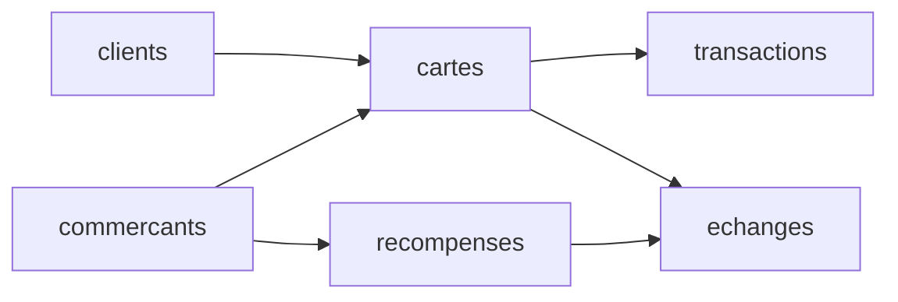

# Programme de fidélité WallX — projet SQL avancé

Base PostgreSQL d'un programme de fidélité : une carte par (client, commerçant),
des points gagnés à chaque achat (1 € = 10 points) et échangés contre des
récompenses. La base garantit elle-même qu'on ne dépense jamais plus de points
qu'on n'en possède, quel que soit le canal (caisse, appli, web).

**Groupe :** Souleymane Sall (@wallxsupport), Lydia El Gh. (@lydia-elgh), Michael Esclavy (@Michi-esc)

## Lancer le projet

Sur une base PostgreSQL vide :

```bash
docker compose up -d
docker compose exec -T db psql -U wallx -d projet < projet.sql
docker compose exec db psql -U wallx -d projet        # pour explorer
```

`projet.sql` s'exécute d'un bloc, dans l'ordre : tables, données, fonction et
procédure, triggers, vues, rôles, index.

## Le modèle

6 tables reliées : `commercants`, `clients`, `cartes` (une par client et
commerçant), `transactions` (les achats qui créditent des points — **20 000
lignes**), `recompenses`, `echanges` (les dépenses de points).



---

## Les éléments du cours

### Fonction — `solde_points(carte)`
- **Ce qu'elle fait :** renvoie le solde d'une carte = points gagnés
  (`transactions`) − points dépensés (`echanges`).
- **Pourquoi :** le solde est calculé à un seul endroit ; le trigger et les vues
  s'en servent sans redéfinir le calcul.
- **La preuve :**
  ```sql
  SELECT solde_points(1);
  ```

### Procédure — `echanger_recompense(carte, recompense)`
- **Ce qu'elle fait :** enregistre un échange après avoir vérifié que la carte
  existe et est active, et que la récompense appartient au bon commerçant. Elle
  refuse les cas invalides avec `RAISE EXCEPTION`.
- **Pourquoi :** c'est une action (elle écrit) ; en cas d'erreur, tout est annulé,
  jamais d'échange à moitié écrit.
- **La preuve :**
  ```sql
  CALL echanger_recompense(1, 1);                 -- ok
  CALL echanger_recompense(1, 999);               -- ERROR: Récompense 999 indisponible
  ```

### Trigger — `echanges_verifier_solde` (BEFORE INSERT ON echanges)
- **Ce qu'il fait :** refuse tout échange dont le coût dépasse le solde de la
  carte.
- **Pourquoi dans la base plutôt que dans l'application :** la règle doit tenir
  quel que soit le chemin (caisse, appli, web). Si chaque application la
  vérifiait de son côté, un seul oubli permettrait de créer des points à partir
  de rien. En base, elle est impossible à contourner.
- **La preuve :**
  ```sql
  -- une carte dont le solde est insuffisant pour 999 999 points
  INSERT INTO echanges (carte_id, recompense_id, points_depenses)
  VALUES (1, 1, 999999);     -- ERROR: Solde insuffisant pour la carte 1 : solde = ..., demandé = 999999
  ```
- **Second trigger** `transactions_carte_active` : une carte bloquée ne gagne
  plus de points (`INSERT INTO transactions` refusé sur une carte `bloquee`).

### Vues
- **`vue_caissier` :** solde d'une carte + client au nom masqué (`Prenom N.`),
  sans e-mail ni nom complet. Le caissier a le droit sur la vue, **pas** sur la
  table `clients`.
- **`vue_analyste` :** statistiques agrégées par commerçant (cartes, nombre de
  transactions, points distribués, CA). Aucune donnée nominative.
- **Pourquoi :** la vue cache la complexité des jointures et protège les données
  personnelles. On donne le droit sur la vue, pas sur les tables.

### Rôles et privilèges
- **`caissier`** (rôle-métier, utilisateur `emma`) : lit le catalogue et
  l'historique, crédite des points, enregistre des échanges — mais ne lit pas la
  table `clients`.
- **`analyste`** (rôle-métier, utilisateur `hugo`) : lecture seule, et seulement
  sur `vue_analyste`.
- **Pourquoi :** moindre privilège. Les droits vont au rôle-métier ; la personne
  en hérite. Quand elle part, on supprime la personne, pas les droits.
- **La preuve :**
  ```sql
  SET ROLE emma;
  SELECT * FROM vue_caissier LIMIT 3;   -- autorisé
  SELECT * FROM clients LIMIT 3;        -- ERROR: permission denied for table clients
  RESET ROLE;

  SET ROLE hugo;
  SELECT * FROM vue_analyste;           -- autorisé
  SELECT * FROM transactions LIMIT 3;   -- ERROR: permission denied for table transactions
  RESET ROLE;
  ```

### Index (justifiés par une mesure avant / après)
On mesure avec `EXPLAIN ANALYZE` (lancer **deux fois**, garder la 2ᵉ mesure),
d'abord sans l'index, puis après l'avoir créé.

Mesures faites sur 20 000 transactions (PostgreSQL 16, `EXPLAIN ANALYZE` lancé
deux fois, 2ᵉ mesure retenue).

**Index 1 — `transactions_carte_idx` sur `transactions(carte_id)`**
L'historique d'une carte. Clé étrangère : PostgreSQL ne l'indexe pas tout seul.
```sql
EXPLAIN ANALYZE SELECT * FROM transactions WHERE carte_id = 42;
```
- Avant : `Seq Scan`, **1,23 ms**
- Après : `Bitmap Index Scan` via `transactions_carte_idx`, **0,05 ms** — ~23× plus rapide.

**Index 2 — `transactions_cree_le_idx` sur `transactions(cree_le)`**
Les transactions d'une journée.
```sql
EXPLAIN ANALYZE SELECT * FROM transactions
WHERE cree_le >= '2026-03-01' AND cree_le < '2026-03-02';
```
- Avant : `Seq Scan`, **1,58 ms**
- Après : `Bitmap Index Scan` via `transactions_cree_le_idx`, **0,12 ms** — ~13× plus rapide.

**L'index inutile (pour montrer le jugement)** : un index sur
`transactions(montant_euros)` pour une requête qui ramène (presque) toute la
table reste en `Seq Scan` — PostgreSQL ignore l'index, car lire l'index puis
toute la table coûterait plus cher que lire la table directement.
```sql
EXPLAIN ANALYZE SELECT * FROM transactions WHERE montant_euros > 0;  -- 20 000 lignes
```
- Avec ou sans index : `Seq Scan`, ~5 ms. On ne garde donc pas cet index
  (`DROP INDEX`).

---

## Contribuer
Chaque membre commite son propre travail — l'historique Git montre qui a fait
quoi. Une partie par personne (tables/données, fonction/procédure/trigger,
vues/rôles, index/README).
